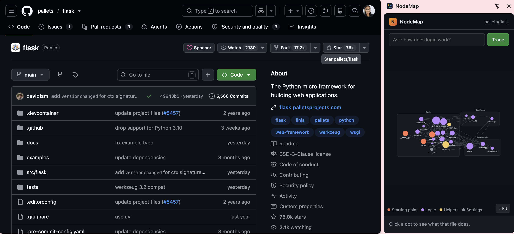

# NodeMap 🗺️

**Google Maps for a codebase.** NodeMap is a Chrome extension that turns any GitHub repository into an interactive map of its files, then explains each part in plain English using **Gemma 4 running locally on your laptop**.

> Built at **RowdyLaunch**, Hacktoberfest Hack Day at UTSA, October 31, 2026
> Tracks: 📚 **Open Source Education** · 🤖 **Best Open-Source AI Project (Gemma 4)**

<!-- TODO: add a screenshot or GIF of the side panel -->


---

## The problem

Lots of students can code but have never contributed to open source. One of the biggest reasons: **you open a real project, see 200 files, and have no idea where to start.** There's no roadmap, the code is unfamiliar, and nothing tells you which file does what or how they fit together. Most beginners close the tab right there.

## Who it's for

**Students who know how to code but have never contributed to open source.** Classes teach you to write small programs from scratch. They don't teach you how to read someone else's large codebase, which is the first thing every contribution requires.

## What it does

Open any GitHub repo and click the NodeMap icon. A side panel opens next to the code:

| Feature | What you get |
|---|---|
| 🗺️ **The map** | Every file is a dot, every import is a line. Dots are sized by importance, colored by role (starting point, UI, logic, data, helpers, settings) and grouped into named sections. |
| ⭐ **Start here** | A plain-English overview of the project and the best file to read first. |
| 👆 **Click a file** | A short explanation of what it does, what it uses, and what uses it. Click any connected file to jump to it. |
| 🔍 **Explain in detail** | A guided tour of one file: its purpose, main parts, how it connects, what to be careful about when editing, and the jargon you'll need. |
| 💬 **Trace a feature** | Ask "how does login work?" and the files involved light up one by one, in order, with a sentence for each step. |
| 📍 **You are here** | As you browse files on GitHub, the map highlights the one you're looking at. |

Answers **stream in word by word**, with live status updates ("Reading main.py… Following 2 imports… Putting it in plain English…") so you're never staring at a blank screen.

## What makes it different

- **The connections are real, not AI guesses.** NodeMap reads the actual `import` / `require` / `<script>` lines in the code to draw the map. Gemma only *explains* those connections, so the map never shows a link that doesn't exist.
- **It lives next to the code.** Instead of a separate website or a generated wiki, it sits in Chrome's side panel and follows you as you browse GitHub.
- **It's built for beginners.** Developer tools like code search assume you already know what to look for. NodeMap tells you where to start.
- **It's private and free.** Gemma 4 runs locally through Ollama. No code leaves your laptop, and there are no API costs, which matters for students.

## How Gemma 4 is used

NodeMap uses **Gemma 4 E2B** through **Ollama**, all on-device:

1. **Project overview:** reads the README and file list, writes a beginner summary, names each section of the map, and picks a "start here" file.
2. **File explanations:** reads a compact *outline* of a file (its comments and function/class definitions) and explains it in two sentences.
3. **Detailed tours:** reads the file's code and writes a sectioned walkthrough.
4. **Feature tracing:** given a question, the file list and the real import graph, picks the files involved and puts them in order. Any file name Gemma invents is filtered out.

Speed on a laptop CPU, which is how most students will run it:
- The **map appears in about 1 second** (no AI needed).
- Gemma makes only **one** call up front; files are explained when you click them.
- Responses **stream**, and Gemma 4's "thinking mode" is turned off for short answers.
- Everything is **cached**, so anything you've opened before loads instantly.

## How to run it

### 1. Install Gemma 4 with Ollama
1. Install Ollama from [ollama.com/download](https://ollama.com/download).
2. Download the model:
   ```bash
   ollama pull gemma4:e2b
   ```
3. Allow the Chrome extension to talk to Ollama, then restart Ollama:
   - **Windows (PowerShell):** `setx OLLAMA_ORIGINS "chrome-extension://*"`, then quit Ollama from the system tray and open it again.
   - **macOS / Linux:** `OLLAMA_ORIGINS="chrome-extension://*" ollama serve`

### 2. Load the extension
1. Clone this repo:
   ```bash
   git clone https://github.com/AustinOkuno/NodeMap.git
   ```
2. Open `chrome://extensions` in Chrome and turn on **Developer mode**.
3. Click **Load unpacked** and choose the folder you cloned.

### 3. Use it
1. Open any GitHub repository, e.g. [pallets/flask](https://github.com/pallets/flask).
2. Click the **N** icon in the toolbar.
3. Click a dot, press **Explain in detail**, or ask a question and press **Trace**.

**Optional:** to use a faster laptop's GPU, change `baseUrl` in `lib/gemma.js` to that machine's address. To try the engine from the terminal:
```bash
node test/run.mjs https://github.com/pallets/flask --ai --ask "how does a request get handled?"
```

## Run it at your club or class

NodeMap works on **any public GitHub repository**, so any club, class or open source project can use it:
- **Workshops:** point students at a beginner-friendly repo and have them find where a feature lives before they write any code.
- **Maintainers:** link it from your CONTRIBUTING guide so newcomers can get oriented on their own.
- **Different languages:** explanations can be generated in other languages by changing the `language` option in `analyzeRepo()`.

## How it works

```
GitHub repo
   │  2 API calls (repo info + full file list) + raw file contents
   ▼
lib/parser.js   finds import / require / <script src> lines (JS/TS, Python, HTML)
   ▼
lib/graph.js    builds the map: files, connections, importance, roles, sections
   ▼  (map is drawn now, ~1s)
lib/gemma.js    Gemma 4 via Ollama: overview, file explanations, tours, traces (streamed)
   ▼
sidepanel.js    draws it with Cytoscape.js in Chrome's side panel
```

| Path | What it does |
|---|---|
| `manifest.json`, `background.js` | Chrome extension setup (Manifest V3) |
| `sidepanel.html`, `sidepanel.js` | The map, file details, tracing and "you are here" |
| `lib/analyze.js` | Public API the side panel calls; caching |
| `lib/github.js` | Fetches repo info, file list and file contents |
| `lib/parser.js` | Finds connections between files; builds code outlines |
| `lib/graph.js` | Builds and ranks the map |
| `lib/gemma.js` | All Gemma 4 prompts and calls (Ollama, plus optional Google AI Studio) |
| `test/` | Terminal tests for the engine |

## Limitations

- Understands connections in **JavaScript/TypeScript, Python and HTML** only.
- On a laptop without a graphics card, detailed tours and traces can take 20–40 seconds (they stream as they go).
- Chrome only; requires Ollama running locally.
- Unauthenticated GitHub requests are limited to 60 per hour per network. NodeMap uses only 2 per repo and caches results.

## What we built today

Everything in this repo was written during the hacking window (10:45 AM to 4:00 PM, Oct 31). We built the import parser, graph builder, Gemma prompts and streaming, the Chrome extension, and the side panel UI.

**Existing tools we used:** [Gemma 4](https://ai.google.dev/gemma) (Google DeepMind), [Ollama](https://ollama.com), [Cytoscape.js](https://js.cytoscape.org), the GitHub REST API.

**AI coding tools used:** Claude (Anthropic). TODO: add any others you used.

## Team

| Name | Role | GitHub | LinkedIn |
|---|---|---|---|
| Austin Okuno | Analysis engine, Gemma integration | [@AustinOkuno](https://github.com/AustinOkuno) | [LinkedIn](https://www.linkedin.com/in/austin-okuno-557922431/) |
| Naomi Teklemichael | Chrome extension, map UI | [@NaomiTeklemichael](https://github.com/naoml05) | [LinkedIn](https://linkedin.com/in/naomiteklemichael) |

## License

[MIT](LICENSE). Free to use, change and share.
